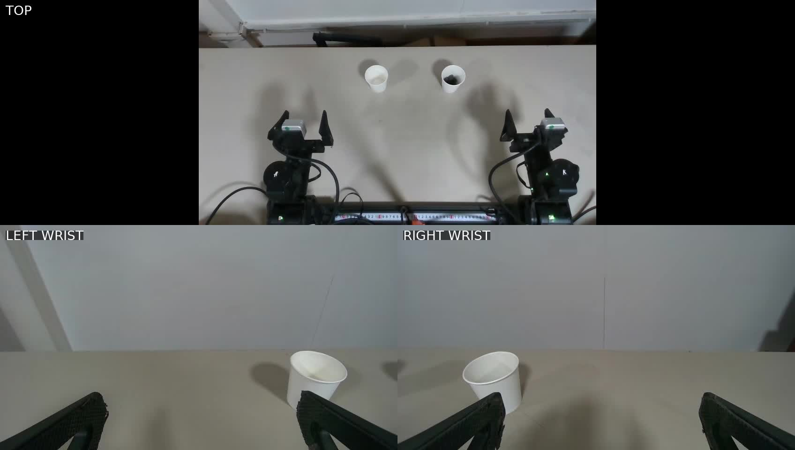

# Spill

Prompt-driven pill transfer with Karma’s bimanual YAM, three RealSense cameras,
and **Dream1 Beta** (`dreamlabs/dream-1-beta`). Dream predicts joint trajectories;
Karma owns the motors and retains its native protection. Viser shows the cameras,
robot state, predictions, and operator controls.



*Initial phase, 00:01 of `exports/20261107T101729-6bbb5b03-three-cameras.mp4`.
This is a recorded setup image, not evidence of a completed transfer.*

## Quick start

Run commands from the `spill/` directory inside your Karma checkout. Python 3.12
and dependencies are managed by uv; Karma is an editable dependency at `..`.
The cell needs its configured CAN interfaces and connected RealSense cameras.

```bash
uv sync --locked
uv sync --locked --project dream_runtime
```

On this cell, `config/local.json` already contains the device mappings below.
For a fresh checkout of the same cell, create it from the supplied profile
(the command preserves an existing local configuration):

```bash
cp -n config/pill-transfer.example.json config/local.json
```

For another rig, edit the CAN interfaces and camera serials before running.

Set the Dream API key in your terminal:

```bash
export DREAM_API_KEY="your-dream-api-key"
uv run spill
```

**`uv run spill` starts a real hardware run.** With no arguments it loads
`config/local.json`, uses the default prompt below, and runs Dream-only in
zero-shot mode. It enables the viewer and local LeRobot v3 recording. The supplied
profile has a five-minute task limit. Keep the workspace and home path clear and
supervise the run.

| Default | Value |
|---|---|
| Controller | Dream-only; no Astra calls or OpenAI key needed |
| Model | `dreamlabs/dream-1-beta` |
| Left / right arm | `can_left` / `can_right` |
| Top camera | D435 · `348523020354` |
| Left wrist camera | D405 · `254623070863` |
| Right wrist camera | D405 · `254623070417` |
| Model camera roles | `top → overhead`, `left_wrist → wrist_l`, `right_wrist → wrist_r` |
| Task | Full pill-transfer prompt below |
| Geometry | Zero-shot: no measured scene calibration or geometric collision checks |
| Output | `runs/<run-id>/`, including local dataset and model I/O |

Camera ASIC serials are resolved through Karma. All three images are supplied to
Dream with fresh robot state. Model availability is checked using your account;
the harness does not silently substitute another checkpoint. Settings in your
local JSON take precedence over the built-in model default.

The no-argument shortcut is equivalent to:

```bash
uv run spill --config config/local.json run --hardware --zero-shot --dream-only
```

### API keys

`DREAM_API_KEY` must be a valid key with access to the configured Dream checkpoint.
Alternatively, copy `.env.example` to `.env`, fill in `DREAM_API_KEY`, then use:

```bash
uv run --env-file .env spill
```

`.env` is ignored by Git and is **not loaded automatically**. Use the exported
variable for the plain `uv run spill` command, or pass uv’s `--env-file .env`.
Keys are inherited by the isolated Dream worker; never put them in JSON settings
or commit them. `OPENAI_API_KEY` is needed only for the optional `--astra-dream`
and `--astra-only` modes.

## Configure CAN interfaces and cameras

Edit [`config/local.json`](config/local.json), which `uv run spill` loads
automatically when run from this directory. The local file is Git-ignored.
The committed [`config/pill-transfer.example.json`](config/pill-transfer.example.json)
is the starting profile for this cell; copy it as shown in Quick start for a fresh
checkout. Editing the example alone does not change an existing local config.

Update these fields **inside the existing file**, preserving its other settings:

```json
{
  "interfaces": {
    "left": "can_left",
    "right": "can_right"
  },
  "serials": {
    "top": "348523020354",
    "left_wrist": "254623070863",
    "right_wrist": "254623070417"
  }
}
```

| Config field | Physical device | This cell’s value |
|---|---|---|
| `interfaces.left` | SocketCAN interface for the left arm | `can_left` |
| `interfaces.right` | SocketCAN interface for the right arm | `can_right` |
| `serials.top` | Overhead RealSense D435 ASIC serial | `348523020354` |
| `serials.left_wrist` | Left-arm wrist RealSense D405 ASIC serial | `254623070863` |
| `serials.right_wrist` | Right-arm wrist RealSense D405 ASIC serial | `254623070417` |

Left and right refer to the physical arm assignments, not the sides of a camera
image. Use two distinct CAN interfaces and three distinct camera serials. Keep
serials as quoted strings; Karma resolves the ASIC identifiers to camera devices.

Both the local config and the committed profile include a `_comments` object
explaining these fields. This is supported JSON documentation, excluded from
runtime configuration snapshots. Keep JSON valid: use `_comments` rather than
`//` or `#` comments. API keys belong in your shell or `.env`, never in this file.

After changing device assignments, check the configuration and camera availability
without starting motors:

```bash
uv run spill --config config/local.json doctor --zero-shot --cameras
```

To use a different configuration file, select it explicitly:

```bash
uv run spill --config config/my-rig.json run --hardware --zero-shot
```

## Default task

Omitting the task uses this prompt verbatim (apart from whitespace wrapping),
defined in [`src/spill/defaults.py`](src/spill/defaults.py):

Transfer the pills from the source cup into the empty cup. Approach from above and gently grasp the source cup near its rim without crushing its walls or blocking its opening. Leave the receiving cup on the table. Use all three camera views together. When the top camera cannot see the cup because an arm or gripper obscures it, use the wrist-camera views to assess the grasp, cup opening, remaining pills, and alignment with the receiving cup. Do not treat top-camera occlusion alone as task failure; pause if the necessary details are unclear in every view. Position the source cup's pouring edge over the receiving cup's opening. Slowly increase the tilt while maintaining alignment and a stable grasp. If pills remain, continue toward an almost upside-down orientation while keeping the pouring opening above the receiving cup and avoiding collisions. If pills are trapped by the gripper or a folded rim, stop rather than forcing rotation. Once transfer is complete, return the source cup upright, set it on the table, and release only when supported.

This prompt describes the desired behavior. Dream-only has no separate visual
planner checking occlusion, a folded rim, trapped pills, or task completion.
The operator must monitor those conditions and pause or stop as needed. It runs
until the task time limit or an operator/fault stop; it does not automatically
certify that all pills have transferred. Reliable transfer has not been established,
and motor-feedback gaps have occurred in trials.

## Choose a run mode

The no-argument shortcut starts hardware. **Explicit `spill run` stays in mock
mode unless `--hardware` or `--shadow` is supplied.** All run modes default to the
same task and Dream-only selection; `--dream` is an alias for `--dream-only`.

```bash
# Offline smoke run: synthetic cameras, no motors, no API calls.
uv run spill run --no-viz

# Override the task; keep the local rig and Dream-only control.
uv run spill --config config/local.json run "Move the empty cup" --hardware --zero-shot

# Inspect real model predictions with energized arms holding position.
uv run spill --config config/local.json run --shadow --zero-shot --no-park

# Opt into Astra planning/progress checks plus Dream actions (both API keys).
uv run spill --config config/local.json run --hardware --zero-shot --astra-dream

# Read-only preflight: cameras and authenticated Dream model access; no motors.
uv run spill --config config/local.json doctor --zero-shot --cameras --models
```

Useful run options: `--seconds 120` changes the task time limit, `--no-record`
disables dataset packaging, `--no-viz` disables Viser, and `--no-park` disables
the home move on shutdown. Ordinary logs remain enabled with `--no-record`.
Use `uv run spill --help` and `uv run spill run --help` for all commands.

For measured geometric checks, configure and verify a physical calibration using
[commissioning](docs/commissioning.md), then explicitly run without `--zero-shot`.
Example calibration files are templates, not measurements. Zero-shot retains
joint, speed, acceleration, gripper, tracking, freshness, temperature, and native
Karma guards, but skips table, obstacle, self-collision, and inter-arm geometry.

## Viewer and stopping

Open the Viser URL printed at startup (port 8080 by default). The viewer includes
all three cameras, measured arms, trajectory previews, the active task, model
timing, gripper readouts, and pause/resume/shutdown controls. Browser loss does
not stop the local supervisor. Use the printed bind address when connecting
remotely; nominal base placement is labeled uncalibrated in zero-shot mode.

| Control | Behavior |
|---|---|
| Pause / Hold | Invalidate predicted actions; hold measured joints and last commanded gripper opening |
| Resume | Capture fresh observations and predict again |
| Ctrl+C / Home & Stop | Cancel execution, then request Karma’s home-and-shutdown path |
| Second Ctrl+C during parking | Cancel remaining parking; de-energize in place |
| Stop Now | De-energize without parking; software control, not the physical e-stop |

A fault that ends the run homes the arms, then de-energizes. Brief feedback gaps
inhibit commands and invalidate pending predictions; fresh feedback triggers
replanning. See [operator guidance](docs/operations.md) and the
[safety matrix](docs/safety.md).

## Recordings and review

Runs stay local under `runs/<run-id>/`. They include camera observations,
`events.jsonl`, raw and accepted Dream trajectories, commands, timing summaries,
and `episode.md`, `episode.json`, and `model_io_index.json`. Exact SDK inputs and
outputs are indexed in the event log; credentials are not intentionally logged.
The Dream SDK may also transmit observation recordings to its service in addition
to inference.

LeRobot v3 packaging happens **after motor shutdown**, at `lerobot_v3/` within the
run. Recording includes motion and API waits, excludes parking, and resamples
causally to 20 Hz with timestamps retained; gaps over 200 ms split episodes.
Gripper convention is `0=open`, `1=closed`. Faulted/interrupted runs are not labeled
successful. Mock mode is a joint echo with synthetic cameras, not a pouring simulator.

```bash
uv run spill recordings                  # Local recorded top-camera gallery
uv run spill catalog                     # Refresh local episode index
uv run spill report RUN_ID               # Latencies, motion time, retries, stops
uv run spill replay RUN_ID                # Replay without hardware/API calls
uv run spill export-v3 runs/RUN_ID        # Package an older recording
```

For optional historical context, add `--astra-dream --reference-run RUN_ID` to an
explicit hardware run. Astra receives the old episode alongside fresh observations;
Dream receives the newly selected instruction. No old joint sequence is replayed,
and this is not fine-tuning. Reference episodes are not used in Dream-only mode.

Independent human counts determine evaluation success:

```bash
uv run spill label RUN_ID --initial 10 --target 10 --residue 0 --spilled 0 --upright
uv run spill evaluate --suite cup-transfer
```

Mock and shadow runs do not contribute to the real success rate. Existing datasets
are never overwritten; uploads and fine-tuning are not automatic. For command-aligned
LeRobot v2.1 exports, see `uv run spill export --help`.

## Development and further reading

```bash
uv run pytest -q
uv run ruff check src tests
```

- [Architecture](docs/architecture.md) and [validation scope](docs/validation.md)
- [Operating and troubleshooting guide](docs/operations.md)
- [Dream-only and Astra + Dream rollout review](docs/rollout-review-2026-11-08.md)
- [Timing investigation](docs/timing-2026-11-08.md)
- [Experimental Astra-only actions](docs/astra-only.md)
- [Research sources](docs/research.md)

The original Karma CLI is available through `uv run spill karma …`, for example
`uv run spill karma doctor --rig yam_bimanual`. Do not run another robot controller
alongside an active Spill hardware run.
