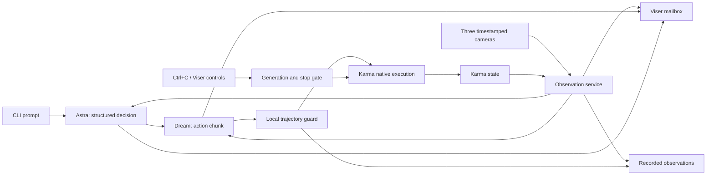

# Runtime architecture

The main thread owns command scheduling and shutdown. Camera threads own the
RealSense pipelines. The observation service collects fresh camera snapshots and
state at up to 30 Hz. Each model has one daemon request worker. The Dream adapter
retains a bounded 5 Hz history plus the latest snapshot, flushes those captured
ticks through the public SDK before inference, and records the exact request
anchor. Capture continues during the network call. The SDK owns its temporal
window and seam smoothing. No private SDK transport APIs are called.

Every model result belongs to a task generation. Pause, resume, recovery and stop
invalidate ownership. A completed obsolete result is discarded. Reset waits for
any previous request to finish before touching the SDK session. A new request
uses fresh telemetry after reset, not a pre-reset image. Hardware shutdown never
waits for a model job.

The baseline plays each verified joint chunk synchronously at the configured
policy sample rate; the native node retains its 200 Hz servo loop. Adaptive
prefetch uses the SDK refill policy, counts actually executed rows during inference,
and validates the remaining trajectory against the current command. Joint goals
are clipped to Karma's ranges and approached within speed, acceleration and
gripper-speed bounds. Discrete braking protects joint boundaries and ends each
chunk at zero commanded joint velocity. Large goals may not be reached within one
chunk; fresh observations close that loop. Nonfinite, expired or infeasible
trajectories are rejected. Acceleration limits are checked at chunk boundaries.
A missed local deadline pauses rather than issuing a catch-up burst.

The planner returns a strict `Decision` schema: execute, observe, pause or finish;
subtasks, active instruction, brief explanation, evidence and outcome. An execute
decision runs a bounded subtask then obtains new observations. Its duration counts
commanded motion only, excluding cloud inference waits, and finishes at a chunk
boundary. Dream continues on fresh observations within that budget instead of
having a slow request consume the entire attempt. Reports distinguish commanded
motion, Dream request time, and subtask wall time; the overall task timeout still
uses wall time. Retryable provider
errors and trajectory rejections enter bounded recovery. Fault recovery is capped
per instruction and globally. Authentication/configuration errors pause for the
operator. Visual counts remain unverified unless independently established.

Viser renders from an independent latest-state mailbox. Model snapshots are
separate from live camera feeds. The ghost is a predicted endpoint, not measured
robot feedback. Predicted actions disappear when their generation is invalidated.
Karma's URDF gripper rendering is static; measured/commanded opening is shown
numerically. UI failure is reported but does not disable local safety checks.

Run records are append-only JSONL plus deduplicated observation NPZ files (JPEG95 images, original numeric state). Exact
encoded API input images are separate events. Exact
per-command measured state and target are kept for replay/export. Evaluation uses
independent labels and excludes mock/shadow runs. Export validates the service training rates and minimum duration, downsampling
20 Hz execution data to 10 Hz without inventing frames. It refuses timing gaps rather
than pretending a variable-duration execution was uniformly sampled training data.

Interfaces are provider-neutral: `Observation`, `ActionChunk`, `Decision`,
`ExecutionReport`, `RunResult`. Another model needs an adapter implementing the
same feed/infer/reset/pacing lifecycle and a verified model-specific action profile.
It does not obtain access to native motor configuration.

Optional pose-assisted/EEF profiles use `dream_runtime/`, a separate locked uv
project containing the full Dream library. A narrow JSON-lines subprocess protocol
supports model setup, listing, reset, buffered observations and inference. It has
no motor/camera operations. Pipes carry arrays; keys stay in the inherited process
environment. Reply deadlines terminate an unresponsive worker. Main-process robot
shutdown does not depend on that worker being responsive. The lightweight native
joint profile runs the official client directly in the main environment.
